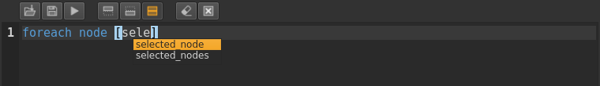

# TCL Editor for Nuke

A small code editor for writing and running **TCL** inside Nuke, much like
the Script Editor does for Python.


**[Download](https://github.com/pitvfx/tcl_editor/releases/latest)** ·
[How to install](#install) · [New to TCL?](#new-to-tcl) ·
[Troubleshooting](#troubleshooting)

### Why TCL? Nuke Indie

Nuke Indie restricts Python. As Foundry's
[Nuke Indie FAQ](https://www.foundry.com/products/nuke-family/nuke-indie/faq)
puts it: *"Calling greater than 10 nodes is not supported, limiting the ability
for automation within scripts."*

That rules out a lot of everyday helpers, like renaming Read nodes, fixing
file paths or changing a knob on every node in a comp. Nuke's built-in TCL
can still do these jobs, and the TCL Editor makes writing it comfortable.
It works just as well in the full version of Nuke.

Nuke's TCL is handy for quick jobs on nodes and knobs, but typing it into a
single expression line gets old quickly. The TCL Editor gives you a proper
editor with:

- **Syntax highlighting** for Nuke's TCL commands, strings, comments and variables
- **Autocomplete** for commands and for the variables you've set
- **Built-in docs**: Ctrl+click a command to read about it
- **Run with Ctrl+Enter**, with the output shown underneath
- **Error highlighting**: the line that failed is marked in red
- **Load and save** `.tcl` files
- Line numbers, bracket matching, auto-closing brackets and quotes,
  auto-indent, and find & replace

## Autocomplete

Start typing a command and the editor suggests the rest, even inside `[ ]`.



Type `$` to pick from the variables you've set. Nuke's own built-in
variables are left out, so the list stays short.


## Docs at your fingertips

Ctrl+click any command to see what it does and which arguments it takes.


## Finding mistakes

When something goes wrong, the error appears in the output and the line it
came from is highlighted.


## Examples

Print the name of every selected node:

```tcl
foreach node [selected_nodes] {
    puts [value $node.name]
}
```

Write your own helper with `proc`. It's added to autocomplete straight away:

```tcl
proc file_of {node} {
    return [value $node.file]
}

foreach node [selected_nodes] {
    puts "[value $node.name]: [file_of $node]"
}
```

## New to TCL?

TCL is a simple language: each line is a command followed by its arguments,
separated by spaces.

- `set name value` stores a value in a variable. `$name` reads it back.
- `[ ]` runs a command and uses its result, a bit like brackets in maths.
- `{ }` groups lines together, for example the body of a loop.
- `#` starts a comment.
- In Nuke, a knob is written as `NodeName.knobname`, for example `Blur1.size`.
  `knob Blur1.size` reads it, `knob Blur1.size 10` sets it.

Select some nodes, paste a recipe into the editor and press **Ctrl+Enter**.
Ctrl+click any command to read more about it. Try new code on a copy of
your comp first.

**Disable every selected node:**

```tcl
foreach node [selected_nodes] {
    knob $node.disable 1
}
```

**Rename the selected nodes to `plate_1`, `plate_2`, …:**

```tcl
set i 1
foreach node [selected_nodes] {
    knob $node.name "plate_$i"
    incr i
}
```

**Swap part of the file path on selected Read and Write nodes:**

```tcl
foreach node [selected_nodes] {
    # skip nodes that have no file knob
    if {[exists $node.file]} {
        regsub -all "/old/server" [knob $node.file] "/new/server" new_path
        knob $node.file $new_path
    }
}
```

Change `/old/server` and `/new/server` to the parts of the path you want to
swap.

To find out what a knob is called, hover over it in the node's properties
panel: the tooltip shows its name in bold.

Save scripts you use often with the **Save** button, and load them later with
**Load**.

## Install

Requires Nuke 16 or newer. You don't need a GitHub account or any
programming experience. It takes about five minutes.

### 1. Download

Go to the [latest release](https://github.com/pitvfx/tcl_editor/releases/latest)
and download **tcl_editor.zip** (under *Assets*). Unzip it. You get a folder
called `tcl_editor`.

> Downloaded with the green **Code > Download ZIP** button instead? That
> folder is called `tcl_editor-master`. Rename it to `tcl_editor`.

### 2. Find your `.nuke` folder

Nuke keeps your personal settings in a folder called `.nuke` in your home
folder:

| System  | Where it is                    |
|---------|--------------------------------|
| Windows | `C:\Users\<your name>\.nuke`   |
| macOS   | `/Users/<your name>/.nuke`     |
| Linux   | `/home/<your name>/.nuke`      |

Nuke creates it the first time it runs. On macOS and Linux it's hidden
because the name starts with a dot:

- **macOS:** in Finder, choose **Go > Go to Folder…**, type `~/.nuke` and press Return.
  (Or press **Cmd+Shift+.** to show hidden files.)
- **Linux:** press **Ctrl+H** in your file manager to show hidden files.

### 3. Move the folder in

Move the `tcl_editor` folder into `.nuke`. Check that `tcl_editor.py` sits
directly inside it, not in another folder below:

```
.nuke/
├── init.py
└── tcl_editor/
    ├── tcl_editor.py
    ├── tcl_commands.json
    ├── menu.py
    └── icons/
```

### 4. Tell Nuke about it

Open `init.py` inside `.nuke` with a plain text editor (Notepad on Windows,
TextEdit on macOS) and add this line at the end:

```python
nuke.pluginAddPath("./tcl_editor")
```

**No `init.py` yet?** Create it as a new text file containing these two lines:

```python
import nuke
nuke.pluginAddPath("./tcl_editor")
```

The file must be called exactly `init.py`:

- **Windows:** in Notepad's *Save as type*, choose **All files**, or you'll
  end up with `init.py.txt`.
- **macOS:** in TextEdit, choose **Format > Make Plain Text** before saving.
  If asked, choose **Use .py**.

### 5. Restart Nuke

Open **Edit > TCL Editor**. If the Script Editor is open, the TCL Editor
opens as a tab next to it.

> **Updating from an older version?** The menu entry is now added
> automatically. You can remove the `import tcl_editor` and `addCommand`
> lines from your `.nuke/menu.py`, and the `pluginAddPath(".../icons")` line
> from `init.py`.

## Shortcuts

| Keys            | Action                                |
|-----------------|---------------------------------------|
| Ctrl+Enter      | Run the code                          |
| Ctrl+Space      | Show completions                      |
| Ctrl+click      | Show the docs for a command           |
| Ctrl+F          | Find and replace                      |
| Esc             | Close the completion list or find bar |

## Good to know

- The first time it opens, the editor saves a list of Nuke's built-in
  variables to `tcl_builtin_vars.json`. To refresh it, for example after a
  Nuke update, delete the file and reopen the editor in a fresh Nuke session.
- Anything printed with `puts` shows up in the output panel.

## Troubleshooting

**There's no "TCL Editor" in the Edit menu**

- Check the folder is called exactly `tcl_editor` (not `tcl_editor-master`)
  and sits inside `.nuke`.
- Check `tcl_editor.py` is directly inside it, not one folder deeper. This
  often happens when unzipping.
- Check the file is called `init.py`, not `init.py.txt`. On Windows, turn on
  **View > File name extensions** in Explorer to see the full name.
- Make sure you restarted Nuke after making the changes.

**Nuke shows an error when it starts**

- Check your Nuke version under **Help > About**. The editor needs Nuke 16
  or newer.
- Check the line in `init.py` is copied exactly, including the quotes and
  brackets.

**My code doesn't do anything**

- Many commands, like `selected_nodes`, work on the nodes selected in the
  Node Graph. Select some nodes first.
- Look at the output panel under the editor. Errors show up there, and the
  line that failed is marked in red.

Still stuck? [Open an issue](https://github.com/pitvfx/tcl_editor/issues) and
include your Nuke version, your operating system and any error message.
(This needs a free GitHub account.)
