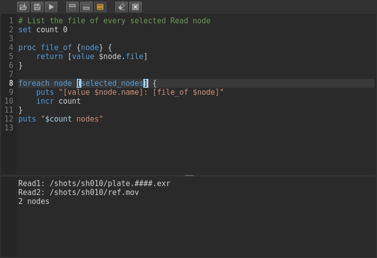
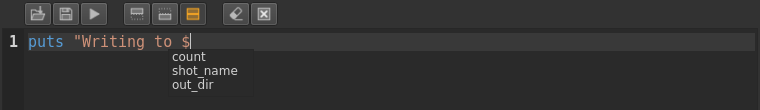
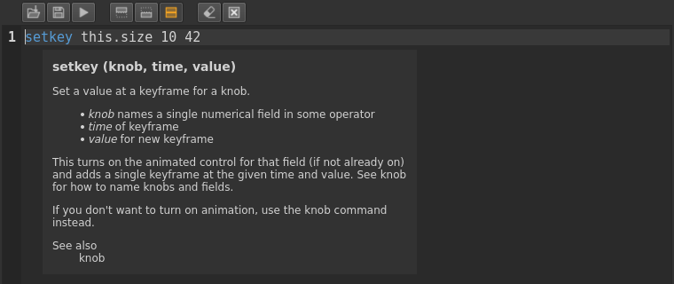
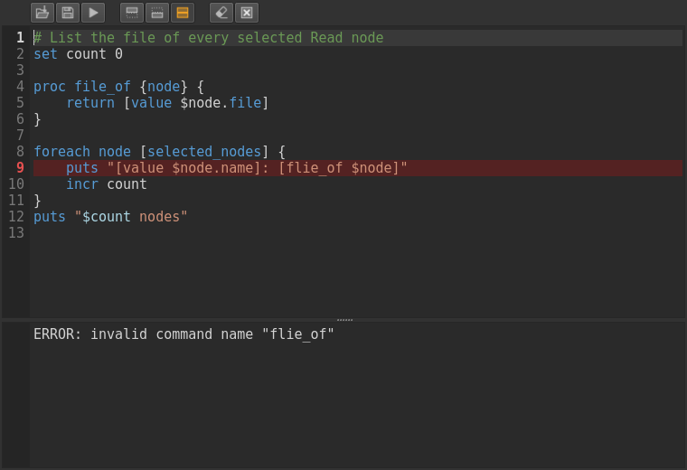

# TCL Editor for Nuke

A small code editor for writing and running **TCL** inside Nuke, much like
the Script Editor does for Python.



### Why TCL? Nuke Indie

Nuke Indie restricts Python. As Foundry's
[Nuke Indie FAQ](https://www.foundry.com/products/nuke-family/nuke-indie/faq)
puts it: *"Calling greater than 10 nodes is not supported, limiting the ability
for automation within scripts."*

That rules out a lot of everyday helpers, like renaming Read nodes, fixing
file paths or changing a knob on every node in a comp. Nuke's built-in TCL
can still do these jobs, and the TCL Editor makes writing it comfortable.
It works just as well in the full version of Nuke.

Nuke's TCL is handy for quick jobs on nodes and knobs, but typing it into a
single expression line gets old quickly. The TCL Editor gives you a proper
editor with:

- **Syntax highlighting** for Nuke's TCL commands, strings, comments and variables
- **Autocomplete** for commands and for the variables you've set
- **Built-in docs**: Ctrl+click a command to read about it
- **Run with Ctrl+Enter**, with the output shown underneath
- **Error highlighting**: the line that failed is marked in red
- **Load and save** `.tcl` files
- Line numbers, bracket matching, auto-closing brackets and quotes,
  auto-indent, and find & replace

## Autocomplete

Start typing a command and the editor suggests the rest, even inside `[ ]`.


Type `$` to pick from the variables you've set. Nuke's own built-in
variables are left out, so the list stays short.



## Docs at your fingertips

Ctrl+click any command to see what it does and which arguments it takes.



## Finding mistakes

When something goes wrong, the error appears in the output and the line it
came from is highlighted.



## Examples

Print the name of every selected node:

```tcl
foreach node [selected_nodes] {
    puts [value $node.name]
}
```

Write your own helper with `proc`. It's added to autocomplete straight away:

```tcl
proc file_of {node} {
    return [value $node.file]
}

foreach node [selected_nodes] {
    puts "[value $node.name]: [file_of $node]"
}
```

## Install

Requires Nuke 16 or newer.

1. Copy the `tcl_editor` folder somewhere, for example `~/.nuke/tcl_editor`.
2. Add it to Nuke's plugin path in your `~/.nuke/init.py`:

   ```python
   nuke.pluginAddPath("./tcl_editor")
   nuke.pluginAddPath("./tcl_editor/icons")
   ```

3. Add a menu entry in your `~/.nuke/menu.py`:

   ```python
   import tcl_editor
   nuke.menu("Nuke").addCommand("Edit/TCL Editor", tcl_editor.editor, icon="tcl_editor.png")
   ```

Restart Nuke and open **Edit > TCL Editor**. If the Script Editor is open,
the TCL Editor opens as a tab next to it.

## Shortcuts

| Keys            | Action                                |
|-----------------|---------------------------------------|
| Ctrl+Enter      | Run the code                          |
| Ctrl+Space      | Show completions                      |
| Ctrl+click      | Show the docs for a command           |
| Ctrl+F          | Find and replace                      |
| Esc             | Close the completion list or find bar |

## Good to know

- The first time it opens, the editor saves a list of Nuke's built-in
  variables to `tcl_builtin_vars.json`. To refresh it, for example after a
  Nuke update, delete the file and reopen the editor in a fresh Nuke session.
- Anything printed with `puts` shows up in the output panel.
